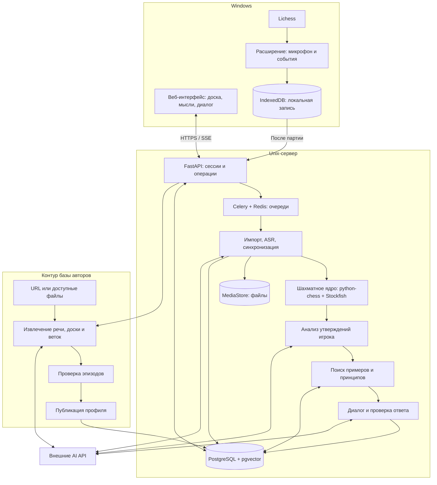
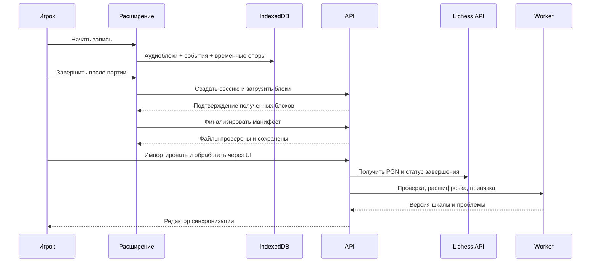

# Архитектура и размещение

## Общий вид

Стрелки обозначают логические зависимости, а не обязательные синхронные HTTP-вызовы. Модули живут в одном серверном кодовом проекте; тяжёлые операции исполняются отдельными процессами worker.

## Модули и границы ответственности

| Модуль | Вход | Выход и ответственность |
|---|---|---|
| Capture | Микрофон, наблюдения страницы Lichess | Локальная сессия, аудиоблоки, время и события; никаких рекомендаций |
| Game Import | PGN или game ID | Проверенный основной вариант, история позиций, статус завершения |
| Alignment | Сессия, партия, ASR | Версионируемая связь реплик с позициями, неоднозначности |
| Chess Core | Позиция с историей, кандидаты | Легальные варианты, оценки и факты с бюджетом поиска |
| Thought Analysis | Реплики, позиция, факты | Утверждения игрока и их классификация |
| Corpus Intake | Источник и доступные материалы | Каталог, контроль доступности, задачи извлечения |
| Episode Extraction | Видео/аудио/PGN | Кандидаты эпизодов, ветки, уверенность и происхождение |
| Knowledge Review | Кандидаты и правки владельца | Проверенные эпизоды и публикуемые принципы |
| Author Profile | Проверенные эпизоды train-раздела | Профиль с условиями применимости и покрытием |
| Retrieval | Автор, позиция, мысли, вопрос | Ранжированный контекст, основания применимости |
| Coach | Контекст и шахматные факты | Проверенный ответ, вопрос ученику, варианты для доски |
| Evaluation | Фиксированные наборы и конфигурации | Метрики, стоимость, сравнение моделей, решение по gate |

AI-провайдеры вызываются через адаптеры: ASR, VideoUnderstanding, TextReasoning, Embeddings. Они не получают прямого доступа к БД и пользовательскому браузеру. Субтитры и речь считаются данными, а не инструкциями системе.

## Поток записи

Контекст записи — отдельная страница/фоновый документ расширения, не popup и не service worker с ограниченным временем жизни. Разрешение микрофона запрашивается при явном запуске. Service worker координирует сообщения; завершение его процесса не должно завершать уже запущенную запись.

Наблюдение ходов реализуется отдельным пассивным адаптером DOM: текущая партия, SAN/номер полухода и наблюдаемое время. Никакого перехвата внутренних WebSocket-протоколов Lichess и программного выполнения ходов. После reconnect пропущенные ходы восстанавливаются как последовательность, но время этих ходов помечается неизвестным. Время получения не выдаётся за время их совершения.

Непрерывность записи проверяется sequence-номерами, длительностями и явными разрывами. Начальный размер блока — около 5 секунд; фактические границы определяются по медиа-времени, а не по обещанной периодичности callback MediaRecorder. Кодек выбирается через поддерживаемые браузером форматы: предпочтительно Opus/WebM. Манифест описывает порядок, формат, контрольные суммы и участки записи.

## Поток разбора

1. Убедиться, что партия завершена; проверить PGN и версию привязки.
2. Рассчитать позиции основного варианта; углубить отмеченные пользователем моменты и позиции с содержательными комментариями или значительным изменением оценки.
3. Разобрать мысли в утверждения; проверить явно названных кандидатов независимо от того, попали ли они в лучшие ходы движка.
4. Найти контекст выбранного автора и проверить применимость.
5. Сформировать структурированный черновик ответа с привязкой фактов и вариантов.
6. Проверить варианты и опорные утверждения; при неудаче выполнить одну корректирующую генерацию. Если она также не прошла, выдать ограниченный ответ с проверенными фактами и явным недостатком данных.
7. Сохранить результат с версиями входов, профиля, модели и анализа; передать пользователю.

Черновой текст LLM не стримится до проверки. SSE передаёт прогресс и затем проверенный ответ. Это предотвращает появление на экране заведомо непроверенных вариантов с последующим исправлением.

## Размещение и стек

| Компонент | Решение v1 |
|---|---|
| Client | TypeScript, React, Vite, react-chessboard |
| Extension | TypeScript, Manifest V3, MediaRecorder, IndexedDB |
| API | Python, FastAPI, Pydantic, SQLAlchemy, Alembic |
| Chess | python-chess, отдельный процесс Stockfish через UCI |
| Persistence | PostgreSQL, pgvector, полнотекстовый поиск PostgreSQL |
| Jobs | Celery + Redis; состояние результата в PostgreSQL |
| Media | Локальные файлы по ключам MediaStore; метаданные в PostgreSQL |
| Video | FFmpeg, OpenCV, внешний мультимодальный API |
| Deployment | Docker Compose, Caddy для HTTPS, один Unix-хост |

На осмотренном сервере: 8 vCPU, около 17 GiB RAM, 94 GiB свободного места на 9 ноября 2026. GPU не подтверждён. Это описание среды, а не результат нагрузочного теста.

Начальные лимиты: один worker подготовки видео; один worker engine с одним процессом Stockfish (2 threads, 512 MiB hash); отдельный worker интерактивных запросов. Фоновая индексация embeddings — последовательно. До измерений не увеличивать параллелизм автоматически.

Базовый бюджет поиска: MultiPV 3 и 1 секунда на позицию, углубление до 10 секунд в обсуждаемой позиции и для проверки кандидатов. Результат хранит фактические depth/nodes/time. Незначительное различие оценок не превращается автоматически в ошибку игрока. Это стартовый профиль измерений, а не гарантия достаточной глубины.

## Надёжность и доступ

- Один аккаунт с серверной сессией в HttpOnly Secure cookie; CSRF-защита операций изменения. Расширение использует отдельный отзываемый токен только для записи/загрузки, без доступа к анализу.
- Секреты провайдеров только на сервере; нет публичных ссылок на пользовательское аудио.
- Задания повторяемы по ключу входной версии и конфигурации. Повтор доставки сообщения очереди не создаёт новый опубликованный результат.
- Истёкший heartbeat позволяет восстановить задачу. Сбой Redis не должен уничтожать единственную запись о задании: таблица jobs/outbox находится в PostgreSQL.
- После таймаутов провайдера стоимость повторного запроса может быть неопределённой; это фиксируется в журнале расходов. Абсолютное exactly-once выполнение внешнего API не обещается.
- При недоступности AI доступны запись, импорт, редактор и прежние результаты. При отказе движка новые конкретные рекомендации не публикуются.
- Ошибки модели не запускают бесконечные автоматические попытки: одна корректирующая генерация; транспортные retry — до трёх с задержкой и учётом Retry-After.

## Хранение и эксплуатация

Пользовательское аудио сохраняется до явного удаления. Временные медиа корпуса удаляются через 7 дней после успешной обработки и проверки; проверенные расшифровки, эпизоды и нужные для аудита материалы сохраняются. При свободном месте менее 20 GiB загрузка новых видео приостанавливается; при менее 10 GiB новые серверные записи файлов отклоняются, локальная запись продолжает работать с предупреждением.

Расширение удаляет локальную копию только после проверки загрузки сервером и явной команды пользователя. Оно контролирует квоту IndexedDB и сигнализирует об опасности заполнения.

Резервное копирование: ежедневный согласованный экспорт БД и постоянных медиа в отдельное от сервера хранилище, 7 ежедневных и 4 еженедельных копии. RPO до 24 часов; целевой RTO 4 часа проверяется восстановлением. Адрес резервного хранилища и домен — параметры установки, до их настройки критерий эксплуатации не выполнен.

Мониторинг v1: структурированные логи с job/session ID, длительность очередей, ошибки API, расход токенов и денег, свободный диск, состояния stale и доля ручных исправлений. Аудио, полные prompts и секреты не включаются в обычные эксплуатационные логи; диагностические входы хранятся отдельно с доступом владельца.
