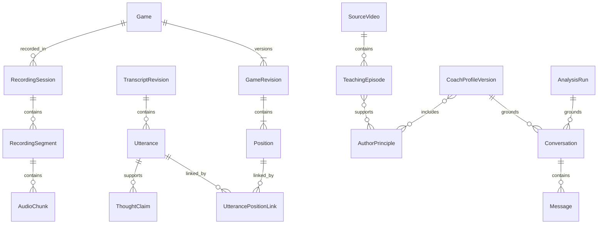

# Модель данных и инварианты

## Общие соглашения

- Внутренние идентификаторы — UUID. Внешний Lichess game ID хранится отдельным полем.
- Служебное время — UTC; время внутри медиа — целые миллисекунды. Интервалы полуоткрытые: `[start_ms, end_ms)`.
- `ply` — число уже совершённых полуходов: 0 означает стартовую позицию. Ход с номером `ply=1` переводит позицию 0 в позицию 1.
- Ход хранится в UCI; SAN вычисляется относительно конкретной позиции. В пользовательском тексте допускаются русские обозначения, но они не заменяют машинную форму.
- Полный FEN и история партии сохраняются. Неизвестные части состояния из видео не заменяются догадками.
- Статусы уверенности: `verified`, `probable`, `ambiguous`, `unknown`. Числа провайдера сохраняются как диагностика, а не выдаются за откалиброванную вероятность.
- Производные результаты неизменяемы после публикации. Изменение создаёт новую версию и обновляет указатель текущей версии.

## Сущности

| Сущность | Основные поля | Связи и назначение |
|---|---|---|
| Owner | id, locale, preferences | Один владелец v1; FK предотвращает случайное смешивание данных |
| Game | id, source, external_id?, player_color, variant, result, completion_evidence, current_revision | Основной объект партии |
| GameRevision | id, game_id, revision, raw_pgn, digest, headers, initial_fen | Проверенный неизменяемый разбор PGN |
| Position | id, game_revision_id, ply, fen, history_ref, position_key | Состояние после `ply` полуходов |
| Move | game_revision_id, ply, uci, san, clock_after_ms? | Переход между соседними позициями |
| RecordingSession | id, game_id?, capture_mode, state, manifest_revision | Браузерная или импортированная запись |
| RecordingSegment | id, session_id, sequence, start_anchor, end_anchor?, gaps | Непрерывный участок одной шкалы времени |
| MediaAsset | id, storage_key, mime, size, sha256, duration_ms?, retention_class | Аудио, видео, проверочные кадры |
| AudioChunk | session_id, segment_id, sequence, asset_id, media_start_ms, media_end_ms | Уникальность `(session_id, segment_id, sequence)` |
| MoveObservation | session_id, segment_id, sequence, observed_ms, ply?, san?, origin, timing_status | Наблюдение, не окончательная истина о партии |
| TranscriptRevision | id, media_manifest_digest, provider, model_version, revision | Версия распознавания или ручной коррекции |
| Utterance | id, transcript_revision_id, segment_id, start_ms, end_ms, raw_text, edited_text?, speaker | Фраза со ссылкой на исходный участок медиа; время относительно segment_id |
| AlignmentRevision | id, game_revision_id, transcript_revision_id, revision, method | Версия привязки |
| UtterancePositionLink | utterance_id, position_id, relation, confidence, reviewer? | Связь многие-ко-многим; relation: before_move / after_move / candidate_line / general |
| EngineAnalysis | id, position_ref, history_digest, engine_build, config_digest, search_budget, result | Оценки, PV и проверка кандидатов |
| ThoughtClaim | id, utterance_ids, position_ref, text, kind, assessment, evidence_refs, revision | Структурированная мысль игрока |
| SourceVideo | id, author_id, external_url?, asset_id?, metadata, access_state, split_group | Источник с идентификатором автора |
| TeachingEpisode | id, source_id, interval, revision, state, transcript_refs, board_track, explanation, themes | Проверяемая единица знаний |
| EpisodeLine | id, episode_id, parent_line_id?, root_position, moves, state_completeness | Основная партия или демонстрационный вариант |
| AuthorPrinciple | id, author_id, revision, statement, conditions, exceptions, support_refs, state | Обобщение с основаниями и ограничениями |
| CoachProfileVersion | id, author_id, version, principle_versions, episode_set_digest, coverage, split_manifest, state | Опубликованная версия профиля |
| KnowledgeIndexVersion | id, profile_version_id, embedding_model, dimensions, corpus_digest | Совместимая версия поискового индекса |
| AnalysisRun | id, game_revision_id, alignment_revision_id, model_config, engine_config, state | Анализ партии и мыслей без привязки к автору |
| Conversation | id, analysis_run_id, profile_version_id, current_position_ref, state | Диалог с одним автором и закреплённой версией |
| Message | id, conversation_id, role, input_text, response, position_ref, evidence_refs, model_config | Версионированный проверенный ответ |
| Job | id, kind, input_versions, dedup_key, status, progress, attempt, heartbeat, result_ref?, error? | Фоновая операция |
| UsageRecord | id, job_id, provider_request_id?, model, units, price_snapshot, cost?, cost_status | Расход и неопределённость после сетевых сбоев |
| EvaluationRun | id, dataset_version, config, outputs, ratings, usage_refs, gate_result | Воспроизводимый эксперимент |

## Связи

ER-диаграмма сокращённая: join-таблицы для многих-ко-многим и ссылки на версии описаны в таблице сущностей.

## Время и синхронизация

У каждого непрерывного участка записи есть медиа-шкала и опоры к локальному монотонному времени. Для обмена между контекстами браузера используется калибровка смещения и диапазона неопределённости по нескольким сообщениям. UTC используется для поиска сессии, но не как источник точного выравнивания звука.

Реплика не пересекает разрыв записи: на границе участков создаются отдельные Utterance с общей смысловой группой при необходимости. Интервал эпизода источника корпуса измеряется относительно начала исходного видео; он не смешивается со шкалой пользовательской записи.

Во время записи сохраняются повторные опоры. Смещение и дрейф оцениваются по участкам. После сна компьютера, перезагрузки вкладки или разрыва аудио создаётся новый участок. Время отсутствующих ходов не интерполируется как достоверное.

Реплика во время обдумывания хода `n` по умолчанию связывается с позицией `n-1`. Это стартовая гипотеза; смысл фразы и ручное исправление могут изменить связь. Высказывание о предыдущем ходе, план на несколько ходов или вариант получает отдельную связь. Граница реплики не обязана совпадать с границей хода.

PGN с `%clk` даёт данные часов, но оценка прошедшего времени может быть искажена добавлением времени, задержками, компенсацией лага и паузами. Метод привязки явно хранится: `captured_events`, `clock_estimate`, `video_alignment`, `manual`. Импорт аудио без временных опор остаётся неоднозначным до ручного уточнения.

## Позиции и движок

`position_key` для поиска транспозиций учитывает фигуры, очередь хода, права рокировки и значимое взятие на проходе. Он не является ключом достаточным для движкового кэша: история повторений и счётчик полуходов могут менять результат.

Ключ кэша анализа включает полное состояние, релевантную историю, версию движка и NNUE, параметры, ограничение поиска и набор проверяемых кандидатов. При невозможности доказать эквивалентность истории кэш не переиспользуется.

Оценка хранится с явной перспективой `white`, отдельными полями `cp` либо `mate`, а также WDL, когда он доступен. Для объяснения оценка переводится в перспективу игрока. Мат не преобразуется в условное число пешек. Сравниваются продолжения из одного корня и сопоставимого бюджета; смена знака при ходе чёрных тестируется отдельно.

## Состояния

| Объект | Переходы |
|---|---|
| RecordingSession | recording → stopped → uploading → uploaded; также incomplete, deleted |
| Game | imported → validated → awaiting_completion / ready; invalid при ошибке PGN |
| Episode | extracted → needs_review → verified / rejected → superseded |
| Principle/Profile | draft → needs_review → published → superseded / withdrawn |
| Job | queued → running → succeeded / failed / cancelled; running → retry_wait → queued |
| Analysis/Message | generated → checked → published; отдельные freshness: current / stale |

Для Lichess завершение подтверждается сервером платформы. Для импортированного PGN без доступной платформы требуется финальный Result и явное подтверждение пользователя, что партия завершена. Эта декларация отмечается отдельно от подтверждения платформой; v1 не обещает предотвратить намеренное злоупотребление импортом.

## Версии и пересчёт

| Изменение | Что устаревает |
|---|---|
| PGN / начальная позиция | Привязки, шахматный анализ, утверждения и ответы на зависимых позициях |
| Расшифровка или привязка | Зависимые утверждения и ответы; движковый анализ прежней позиции остаётся пригодным |
| Эпизод или принцип | Индекс и новая версия профиля; опубликованные версии сохраняются для аудита |
| Модель embeddings | Новый индекс; смешивание размерностей/версий запрещено |
| Движок или бюджет | Новая версия анализа; прежний результат остаётся с маркировкой |

Диалог закрепляет версии. После правок старый разговор доступен для чтения с отметкой об устаревании; продолжение создаёт разговор на новых версиях. Нельзя незаметно продолжать старый вывод на изменённой позиции.

Удаление пользовательского аудио удаляет соответствующие файлы и производные тексты по выбранному пользователем объёму удаления. Удаление источника корпуса выводит его эпизоды и зависимые профили из активного поиска; история содержит отметку об удалении без сохранения удаляемого содержимого. Резервные копии очищаются по установленному сроку хранения.
